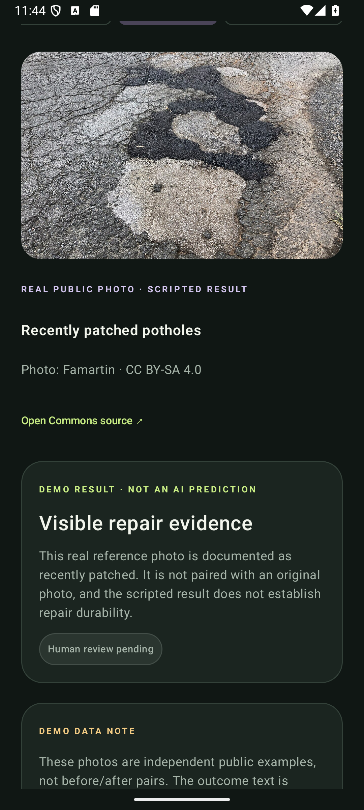

# VERIDEX for Android

VERIDEX Android 2.1 captures pothole evidence and follows repair review. Kotlin, Jetpack Compose, CameraX and WorkManager. Charcoal surfaces, lime accents and a responsive, scrollable interface.

## Open and run

1. Open **this folder** in Android Studio (the folder containing `settings.gradle.kts`).
2. Let Gradle sync. Use a JDK 17 or 21 Gradle JVM and install Android SDK 35 if requested. Minimum phone version: Android 8 / API 26.
3. Select an emulator or USB-connected phone and press Run.

Command line on Windows:

```powershell
.\gradlew.bat assembleDebug lintDebug
```

APK: `app/build/outputs/apk/debug/app-debug.apk`.

If Windows reports `Unable to establish loopback connection` from `UnixDomainSockets`, use a short, writable temporary socket path for the build process:

```powershell
New-Item -ItemType Directory -Force C:\veridex-build-temp
$env:JAVA_TOOL_OPTIONS='-Djdk.net.unixdomain.tmpdir=C:\veridex-build-temp'
.\gradlew.bat assembleDebug
```

This is a local build workaround, not an app runtime requirement.

## Working flows

- Overview, filtered case list, evidence details, connection settings and a separate interactive demo.
- Real CameraX camera with explicit permission flow and a system photo picker.
- Image normalization, rotation correction, private local storage and a draggable normalized region of interest.
- Manual landmark or foreground location lookup with a manual fallback.
- Automatic current-location capture after taking or importing each photo. The app asks Android for permission, uses a recent cached fix immediately when available, then requests a fresh network/GPS fix and falls back between providers.
- Original, completion and recapture photos kept in the same case.
- Local case persistence across process restarts. Review form fields survive activity recreation.
- Explicit upload action, persistent WorkManager queue and bounded retries for transient errors.
- Before/after comparison, structured result rendering, targeted recapture and evidence history.
- Model/backend failures display errors. They never become repair findings.
- Adjustable original-photo camera overlay with the marked region shown during repair capture.
- On-device brightness, blur and resolution checks, plus orientation/framing warnings for repair photos.
- Searchable cases with local/follow-up/archived filters, rename, archive, restore and delete.
- Location overview for geotagged cases, with links to the device's map app and distance warnings for far-away follow-up photos.
- Resumable capture drafts, photo SHA-256 fingerprints, duplicate-photo warnings and source labels.
- Shareable PDF and JSON evidence reports, scheduled follow-up reminders, and optional voice notes.
- First-run capture and safety guide, with English/Hindi/Kannada selection for the main navigation, onboarding and primary actions.

The original photo and latest after-photo are shown in the comparison. All earlier evidence remains in history. Adding new evidence clears the current finding and increments the revision so stale results cannot apply to a newer submission.

The map is an on-device coordinate plot that does not load third-party tiles. Android requires the user to grant location permission; if permission is denied, Location is off, or the phone has no fix, a landmark can be entered manually. Quality checks are simple local image heuristics; they flag capture issues and do not classify potholes or assess repairs. SHA-256 records the normalized image bytes and helps detect exact duplicates; it does not prove when, where or how a photo was taken. Gallery imports are labelled accordingly.

## Run the included local backend

```powershell
cd backend
python -m venv .venv
.\.venv\Scripts\python.exe -m pip install -r requirements.txt
Copy-Item .env.example .env
.\.venv\Scripts\python.exe server.py
```

Put the registered `VERIDEX_APP_KEY` and Google provider `GEMINI_API_KEY` in `backend/.env` on this machine. Keep that file private; it is ignored by Git. The shipped `.env.example` contains placeholders only. Register the shared app key with `python -m veridex.api --register-app daksha-app --key-from-env` from the repository root (set VERIDEX_APP_KEY in that terminal first). The keys are loaded by the local Python server and is never sent to the Android app or packaged in the APK. The server calls this repository's `veridex.review` pipeline directly, which uses the configured `VERIDEX_MODEL` (default `gemma-4-26b-a4b-it`) and the repository's conservative evidence policy. No separate `MODEL_REVIEW_URL` adapter is needed.

In the app's **Connection** tab:

- Android emulator: `http://10.0.2.2:8080`
- USB phone: run `adb reverse tcp:8080 tcp:8080`, then use `http://127.0.0.1:8080`.

Only these development loopback hosts allow HTTP in the debug build. Release builds require HTTPS.

If port 8080 is already in use, run `server.py --port 8787` and use port 8787 in the app URL and any `adb reverse` command.

Before upload, the user must consent to this exact evidence revision. Consent covers photos, marked areas, notes and captured location being sent through the local backend for model review. New evidence clears consent; withdrawing consent cancels queued work and deletes that case from the backend. The backend independently rejects uploads and reviews without matching current consent. A separate optional training-consent control now allows collection after a successful review. Human labeling and export approval use the operator API, not the mobile app. See ../APP_INTEGRATION.md.

The backend saves consented uploads under `backend/data/<case-id>/`. Duplicate uploads of the same revision are idempotent. A conflicting revision is rejected. Images are validated as normalized JPEGs; each original byte sequence is stored by SHA-256 and every metadata revision is retained. The phone's normalized image is the uploaded evidence; normalization removes EXIF and is not a photo-authentication mechanism.

This server binds to localhost and is for development. It has no user accounts or per-client authorization. Do not expose it publicly. Production requires authenticated users, case-level authorization, TLS, rate limiting, retention/deletion policy, and managed storage. Configure a trusted backend URL only.

## Real app review and offline demo

The **real app** uploads a consented case to the local backend, then invokes the existing Gemma review pipeline and AECP policy. Its only valid results are `visible_repair_evidence`, `visible_defect_remains`, or `insufficient_evidence`; model/provider failures do not become positive findings. A human still makes the final decision. `GET /health` reports whether the app registration and model key are ready, and the Connection screen can check that status.

The separate demo screen bundles three real, openly licensed road-maintenance photos so it works offline without an API key. Its outcomes are preset examples, never model predictions, and the photos are not paired before/after cases. Photo credits and licenses are in `app/src/main/assets/demo/ATTRIBUTION.md`; the round-one talk track is in `ROUND_ONE_DEMO.md`. Demo examples never enter real case records. No classifier accuracy, severity score, repair certification or government complaint closure is invented.



## App-facing API

| Method | Path | Behaviour |
|---|---|---|
| GET | `/health` | Local app registration, model readiness, consent requirement and model identifier |
| POST | `/v1/cases/sync` | Full case snapshot and base64 photos; requires consent for the exact revision |
| POST | `/v1/cases/{id}/review` | Body: `{"revision": 1}`; requires current consent, returns the model finding |
| DELETE | `/v1/cases/{id}` | Deletes the local backend copy when consent is withdrawn |

Uploads contain `id`, `revision`, `location`, `note`, `created` and `photos[]`. Each photo has `role`, `region: [left, top, right, bottom]`, `time`, and `image_base64`. Coordinates refer to the upright normalized image, range 0–1, and must form a non-empty rectangle.

Limits: 12 photos per case, 6 MB per normalized photo, 40 MB HTTP request. Capture downsizes to a maximum 1600px side. For production, replace snapshot/base64 uploads with resumable per-image uploads and object-storage references.

## Verification

```powershell
cd backend
.\.venv\Scripts\python.exe -m unittest -v test_server
```

Backend tests cover durable/idempotent uploads, conflicting evidence, invalid image/region/path inputs, stale reviews, missing before/after pairs, disconnected AI, malformed model output and a valid structured finding.

Manual device checks: camera grant/deny; gallery import; draw/confirm region; save a case; restart app; add after-photo; upload; retry with server unavailable; connect real model; receive targeted recapture; add evidence and confirm the old finding is cleared. Location and physical camera quality should also be checked outdoors on a real phone.

## Limits and next work

- Evaluate the integrated VERIDEX pipeline with labelled real repair pairs; the current key and provider response have not been exercised against live images.
- Authenticated reviewer workflow and timestamped reviewer decisions.
- Full localization of explanatory copy, case details and notification text.
- Room migration as the local dataset grows and additional accessibility review.
- Reviewer accounts and timestamped reviewer decisions.
- Production auth, storage, background review jobs and retention controls.

The app intentionally has no fake inspector approval controls: evidence findings remain pending human review. It does not automatically close civic complaints.

## Design / reference

The screen structure follows the supplied VERIDEX deck: original capture → quality/evidence review → specific recapture → human review. The unrelated general-assistant PDF was not used as the app's product scope.

- [Android CameraX preview guidance](https://developer.android.com/media/camera/camerax/preview)
- [Android offline-first architecture](https://developer.android.com/topic/architecture/data-layer/offline-first)
- [AGP 8.9 compatibility](https://developer.android.com/build/releases/agp-8-9-0-release-notes)
